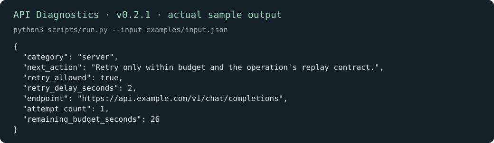
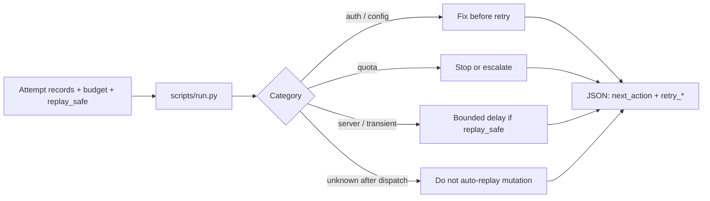

# API Diagnostics

[English](README.md) · [中文](README.zh-CN.md) · **v0.2.1**

[](https://github.com/KarmenLoop/skill-api-diagnostics/releases/latest)
[](https://www.python.org/downloads/)
[](LICENSE)
[](skill.json)
[](SKILL.md)

**Classify API failures and choose bounded, replay-aware next steps—from records you already have.**

When a provider returns 401, 429, 503, or a timeout, the hard part is rarely “try again.” It is deciding whether the failure is configuration, authentication, quota, or server-side—and whether repeating the call is even safe under the operation’s contract. **API Diagnostics** is a portable agent skill plus a local Python helper that reads structured attempt records, remaining budget, and an explicit `replay_safe` flag, then emits a failure category with a bounded retry recommendation. It makes **no HTTP requests** and cannot certify provider idempotency.

Built and maintained by [KarmenLoop](https://github.com/KarmenLoop) / [KARMENLOOP](https://karmenloop.com). Current release: **[v0.2.1](https://github.com/KarmenLoop/skill-api-diagnostics/releases/tag/v0.2.1)**. License: **MIT**.



*Actual local output from v0.2.1, rendered as an image. [Complete result](examples/expected.json) · [Image provenance](docs/images/provenance.json).*

[Download v0.2.1](https://github.com/KarmenLoop/skill-api-diagnostics/releases/tag/v0.2.1) · [Tutorial](docs/tutorial.en.md) · [中文教程](docs/tutorial.zh-CN.md) · [Input contract](docs/INPUT.md)

---

## Why this exists

Agent sessions often collapse every failure into a vague “retry.” That overwrites the real distinctions: a bad base URL is not a rate limit; a credit hard-stop is not a transient 503; a timeout after dispatch may leave an unknown outcome. This package keeps diagnosis local, deterministic, and honest about what the helper can and cannot know.

---

## Snapshot

| | |
|---|---|
| **What you install** | Portable skill (`SKILL.md`, docs, examples) + local helper under `scripts/` |
| **Package name** | `karmen-api-diagnostics` |
| **Version** | **0.2.1** (`skill.json`, release tag, `--version`) |
| **Runtime** | Python **3.9+**, standard library only |
| **Network** | Helper: **offline** (`"network": false` in `skill.json`) |
| **Entry** | `python3 scripts/run.py --input …` · optional `python3 install.py --host agents` |
| **Sample artifact** | [examples/input.json](examples/input.json) → [examples/expected.json](examples/expected.json) |
| **License** | [MIT](LICENSE) — keep [NOTICE.md](NOTICE.md) with redistributed copies |

---

## Is / Is not

| Is | Is not |
|---|---|
| Local failure classifier for supplied API attempt records | Live HTTP client or connection tester |
| Replay-aware next-action advice when `replay_safe` is accurate | Guarantee of provider idempotency |
| Portable skill (`SKILL.md`) + stdlib Python helper | Hosted API monitoring SaaS |
| Budget-aware delay recommendation from elapsed / Retry-After inputs | Automatic payment or mutation replay |
| Works offline; no model account required for the helper | Permission to send, purchase, or change access |

---

## How it works

Two layers stay separate:

1. **Method layer (skill)** — `SKILL.md` tells an agent how to collect endpoint shape, status, timeout stage, and sanitized error codes without printing secrets; how to set `replay_safe` from the real contract; and how to distinguish a diagnosis from an authorized live recovery.
2. **Deterministic helper** — `scripts/run.py` + `scripts/runtime.py` read JSON (file or stdin), classify, and print JSON to stdout. Network is off (`skill.json` → `"network": false`). Stdlib only.

### Flow



### Sample (v0.2.1)

The bundled sample records one **503**, leaves **26** seconds, and—because `replay_safe` is true—recommends a **2-second** delay (`category: server`, `retry_allowed: true`). See [examples/expected.json](examples/expected.json).

---

## Quickstart

### A. Run the helper (no agent host required)

1. Download `karmen-api-diagnostics-v0.2.1.zip` and its `.sha256` from the [v0.2.1 release](https://github.com/KarmenLoop/skill-api-diagnostics/releases/tag/v0.2.1).
2. Verify the hash, then extract.
3. In the extracted directory, with Python 3.9+:

```sh
python3 scripts/run.py --version
python3 scripts/run.py --input examples/input.json
```

Expected version string: `karmen-api-diagnostics 0.2.1`. JSON lands on stdout. Use `--output new-result.json` to keep a copy without overwriting existing files. Pipe mode: `--input -`.

### B. Install the portable skill

For hosts that read `~/.agents/skills` (or a project `.agents/skills`):

```sh
python3 install.py --host agents
```

The installer **refuses an existing destination**—use a fresh path or remove the old copy first. Host discovery and invocation vary; see [docs/tutorial.en.md](docs/tutorial.en.md). You can keep using the helper directly without any AI host.

### Use it with your own work

- Set `replay_safe` from the **endpoint’s actual contract**, not from optimism.
- Include `elapsed_seconds` and any provider `Retry-After` value.
- Record a hard credit limit as **quota**, not as a soft 429.
- Try a 401, then an exhausted budget; compare `next_action` and `retry_allowed` before wiring callers.

Read [docs/INPUT.md](docs/INPUT.md) before preparing new input. The helper needs no model account, API key, or network connection. An AI host has its own data and permission settings; this skill adds no authority to send, purchase, publish, or change access.

---

## Documentation map

| Doc | Use it when you need… |
|---|---|
| [Tutorial (EN)](docs/tutorial.en.md) · [中文](docs/tutorial.zh-CN.md) | Download, install, practice, upgrade, remove |
| [INPUT.md](docs/INPUT.md) · [input.zh-CN.md](docs/input.zh-CN.md) | Field contract |
| [COMPATIBILITY.md](docs/COMPATIBILITY.md) | Host / runtime notes |
| [VALIDATION.md](docs/VALIDATION.md) | What checks cover |
| [SOURCES.md](docs/SOURCES.md) | Provenance pointers |
| [CHANGELOG.md](CHANGELOG.md) | History through 0.2.1 |
| [SECURITY.md](SECURITY.md) / [SUPPORT.md](SUPPORT.md) / [CONTRIBUTING.md](CONTRIBUTING.md) | Ops |

---

## FAQ

### What is API Diagnostics in one sentence?

A MIT-licensed agent skill and offline Python helper that classifies supplied API failure records and recommends bounded, replay-aware next steps—without sending any HTTP request.

### Who should use it?

Operators and developers who already capture attempt logs (status, timing, sanitized errors) and want a repeatable classification before deciding whether a caller may retry.

### Will it retry a failed payment?

No. It neither sends requests nor authorizes repeats. Payment idempotency must come from the payment service and your own policy.

### Does installing the skill grant network or credential access?

No. The helper is local and offline. Host tool permissions remain whatever the host already grants; this skill adds none.

### Where does output go?

JSON to stdout by default. Use `--output` with a **new** filename to retain a result; existing files are preserved.

### How does this differ from “ask the model what the error means”?

The helper is deterministic over a published input contract. The skill forbids inventing attempts and forbids treating a fixture result as proof that an external action happened.

### Soft discoverability

Useful phrases that match this repo: **API failure classification**, **replay-safe retry advice**, **offline API diagnostics skill**, **rate-limit and 503 triage for agents**. Avoid stuffing; the substance is in the skill and helper, not keyword density.

---

## License and contact

[MIT](LICENSE). Keep the license and [NOTICE.md](NOTICE.md) with redistributed copies.

Maintainer: [KarmenLoop](https://github.com/KarmenLoop) · Site: [karmenloop.com](https://karmenloop.com)

Issues: [GitHub Issues](https://github.com/KarmenLoop/skill-api-diagnostics/issues) · Support policy: [SUPPORT.md](SUPPORT.md). Prefer synthetic data when filing example bugs.
