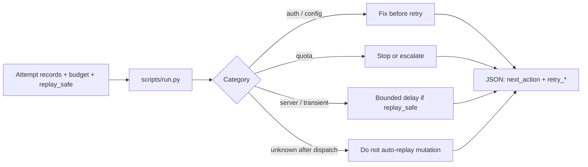

# API 诊断 · API Diagnostics

[English](README.md) · [中文](README.zh-CN.md) · **v0.2.1**

[](https://github.com/KarmenLoop/skill-api-diagnostics/releases/latest)
[](https://www.python.org/downloads/)
[](LICENSE)
[](skill.json)
[](SKILL.md)

**根据已有请求记录，对 API 失败做分类，并给出有边界、可感知重放风险的下一步建议。**

接口返回 401、429、503 或超时之后，难点往往不是“再试一次”，而是分清配置、鉴权、配额还是服务端问题，以及在接口约定下重放是否安全。**API 诊断**是可移植的 Agent Skill，外加本地 Python 助手：读取结构化尝试记录、剩余时间预算与显式的 `replay_safe`，输出故障分类与有边界的重试建议。它**不会发起 HTTP 请求**，也不能代替供应商证明幂等。

由 [KarmenLoop](https://github.com/KarmenLoop) / [KARMENLOOP](https://karmenloop.com) 维护。当前发行版：**[v0.2.1](https://github.com/KarmenLoop/skill-api-diagnostics/releases/tag/v0.2.1)**。许可：**MIT**。


*图片来自 v0.2.1 的真实本地输出（英文键名）。[完整结果](examples/expected.json) · [图片来源记录](docs/images/provenance.json)。*

[下载 v0.2.1](https://github.com/KarmenLoop/skill-api-diagnostics/releases/tag/v0.2.1) · [中文教程](docs/tutorial.zh-CN.md) · [English tutorial](docs/tutorial.en.md) · [输入契约](docs/input.zh-CN.md)

---

## 为什么需要它

对话里很容易把所有失败都说成“再试一次”，从而抹掉关键区别：错误的 base URL 不是限流，硬性额度上限不是短暂的 503，发出后超时可能留下未知结果。本包把诊断留在本地、规则确定，并如实写清助手知道什么、不知道什么。

---

## 一览

| | |
|---|---|
| **安装内容** | 可移植 Skill（`SKILL.md`、文档、样例）+ `scripts/` 下本地助手 |
| **包名** | `karmen-api-diagnostics` |
| **版本** | **0.2.1**（`skill.json`、发行标签、`--version`） |
| **运行时** | Python **3.9+**，仅标准库 |
| **网络** | 助手：**离线**（`skill.json` 中 `"network": false`） |
| **入口** | `python3 scripts/run.py --input …` · 可选 `python3 install.py --host agents` |
| **样例产物** | [examples/input.json](examples/input.json) → [examples/expected.json](examples/expected.json) |
| **许可** | [MIT](LICENSE) — 再分发时保留 [NOTICE.md](NOTICE.md) |

---

## 是 / 不是

| Is | Is not |
|---|---|
| 针对你提交的 API 尝试记录做本地故障分类 | 在线 HTTP 客户端或连通性探测工具 |
| 在 `replay_safe` 准确时给出可感知重放风险的下一步 | 供应商幂等性保证 |
| 可移植 Skill（`SKILL.md`）+ 标准库 Python 助手 | 托管式 API 监控 SaaS |
| 结合剩余预算 / Retry-After 输入给出延迟建议 | 自动重放支付或写操作 |
| 助手可离线运行，不需要模型账号 | 代发请求、代付款或改权限的授权 |

---

## 如何工作

两层刻意分开：

1. **方法层（Skill）** — `SKILL.md` 指导代理如何收集端点形态、状态码、超时阶段与脱敏错误码（不打印密钥），如何按真实接口约定填写 `replay_safe`，以及如何区分“诊断”与“已授权的现场恢复”。
2. **确定助手** — `scripts/run.py` 与 `scripts/runtime.py` 读取 JSON（文件或 stdin），分类后把 JSON 打到 stdout。`skill.json` 标明 `"network": false`，仅用 Python 标准库。

### 流程



### 样例（v0.2.1）

随包样例记录一次 **503**，剩余 **26** 秒；因 `replay_safe` 为 true，建议等待 **2** 秒（`category: server`，`retry_allowed: true`）。详见 [examples/expected.json](examples/expected.json)。

---

## 快速开始

### A. 直接跑助手（不需要 AI 宿主）

1. 从 [v0.2.1 发行页](https://github.com/KarmenLoop/skill-api-diagnostics/releases/tag/v0.2.1) 下载 `karmen-api-diagnostics-v0.2.1.zip` 与对应 `.sha256`。
2. 核对哈希后解压。
3. 在解压目录中使用 Python 3.9+：

```sh
python3 scripts/run.py --version
python3 scripts/run.py --input examples/input.json
```

期望版本字符串：`karmen-api-diagnostics 0.2.1`。JSON 默认输出到 stdout。用 `--output new-result.json` 落盘且不覆盖已有文件。管道：`--input -`。

### B. 安装可移植 Skill

若宿主读取 `~/.agents/skills`（或项目内 `.agents/skills`）：

```sh
python3 install.py --host agents
```

安装器**拒绝已存在的目标目录**——请换新路径或先移除旧副本。宿主发现与调用方式因环境而异；见 [docs/tutorial.zh-CN.md](docs/tutorial.zh-CN.md)。也可以完全不装宿主，只跑助手。

### 用于你自己的工作

- `replay_safe` 必须来自**接口真实约定**，而不是乐观假设。
- 填入 `elapsed_seconds` 以及供应商给出的 `Retry-After`（如有）。
- 硬性额度上限记为 **quota**，不要当成软性 429。
- 试一次 401，再试一次预算耗尽；在接入调用方之前对比 `next_action` 与 `retry_allowed`。

准备新输入前请阅读 [docs/input.zh-CN.md](docs/input.zh-CN.md) / [docs/INPUT.md](docs/INPUT.md)。助手不需要模型账号、API 密钥或网络。AI 宿主有自己的数据与权限设定；本 Skill **不**额外授予发送、购买、发布或改权限的权力。

---

## 文档地图

| 文档 | 用途 |
|---|---|
| [中文教程](docs/tutorial.zh-CN.md) · [English](docs/tutorial.en.md) | 下载、安装、练习、升级、移除 |
| [input.zh-CN.md](docs/input.zh-CN.md) · [INPUT.md](docs/INPUT.md) | 字段契约 |
| [COMPATIBILITY.md](docs/COMPATIBILITY.md) | 宿主 / 运行时说明 |
| [VALIDATION.md](docs/VALIDATION.md) | 校验覆盖范围 |
| [SOURCES.md](docs/SOURCES.md) | 来源与溯源 |
| [CHANGELOG.md](CHANGELOG.md) | 至 0.2.1 的历史 |
| [SECURITY.md](SECURITY.md) / [SUPPORT.md](SUPPORT.md) / [CONTRIBUTING.md](CONTRIBUTING.md) | 运维 |

---

## 常见问题

### 一句话：API 诊断是什么？

MIT 许可的 Agent Skill 与离线 Python 助手：对你提交的 API 失败记录做分类，并给出有边界、可感知重放风险的下一步——本身不发任何 HTTP 请求。

### 适合谁用？

已经能拿到尝试日志（状态、耗时、脱敏错误）的人，希望在决定调用方能否重试之前，有一套可重复的分类流程。

### 会重试失败的支付吗？

不会。它既不发请求，也不授权重放。支付幂等必须来自支付服务与你自己的策略。

### 安装 Skill 会获得联网或凭据权限吗？

不会。助手本地离线。宿主工具权限仍是宿主原有设定；本 Skill 不额外授权。

### 结果写到哪里？

默认 JSON 打到 stdout。用 `--output` 指定**新**文件名可落盘；已有文件不会被覆盖。

### 和“直接问模型这个错误是什么意思”有何不同？

助手对已发布的输入契约是确定的。Skill 禁止编造尝试记录，也禁止把样例结果当成外部动作已发生的证明。

### 温和可发现性

与本仓库实质相符的检索说法：**API 失败分类**、**可重放感知的重试建议**、**离线 API 诊断 Skill**、**面向代理的限流 / 503 分诊**。 避免堆砌；实质在 Skill 与助手里，不在关键词密度。

---

## 许可与联系

[MIT](LICENSE)。再分发时请保留许可证与 [NOTICE.md](NOTICE.md)。

维护者：[KarmenLoop](https://github.com/KarmenLoop) · 站点：[karmenloop.com](https://karmenloop.com)

问题反馈：[GitHub Issues](https://github.com/KarmenLoop/skill-api-diagnostics/issues) · 支持政策：[SUPPORT.md](SUPPORT.md)。提交样例相关问题时请优先使用合成数据。
